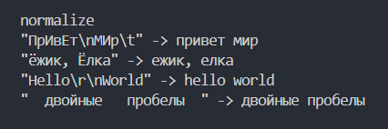
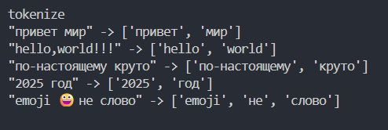
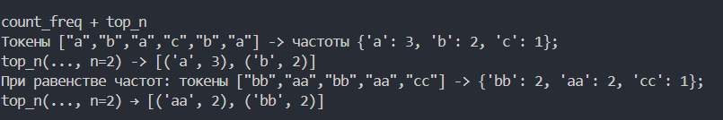
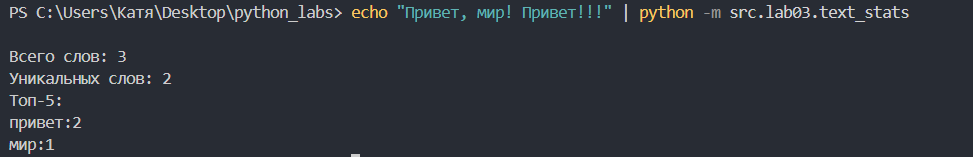
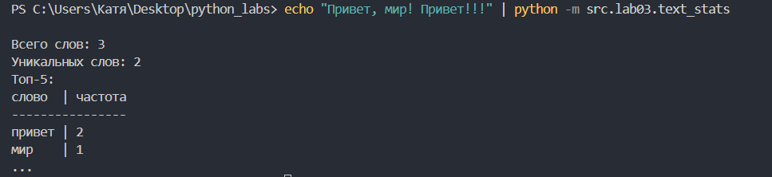

## ЛР3 — Тексты и частоты слов (словарь/множество)

## Задание A

### Задание 1 (normalize)
Функция приводит текст к нормальному виду и выводит на экран. Если просят перевести непонятные символы, то приводим к нормальному виду с помощью casefold
```py
def normalize(text: str, *, casefold: bool = True, yo2e: bool = True) -> str:
    '''
    This function normalizes the text
        
    Input data: str
    Output data: str
    '''
    text1 = text
    if casefold:
        text1 = text1.casefold()
    else:
        text1 = text1.lower()
    if yo2e:
        text1 = text1.replace('ё', 'е').replace('Ё', 'Е')
    text1 = ' '.join(text1.split())
    return text1
```

<br>
*Результат выполнения функции normalize()*

### Задание 2 (tokenize)
Функция разделяет текст на массив, используя re.findall()
```py
import re

def tokenize(text: str) -> list[str]:
    '''
    This function splits the text based on non-alphanumeric indicators
            
    Input data: str
    Output data: list[str]
    '''
    return re.findall(r'\w+(?:-\w+)*', text)
```

<br>
*Результат выполнения tokenize()*

### Задание 3 (count_freq + top_n)
Программа считает символы и выводит n элементов, отсротированных по убыванию количества символов
```py
def count_freq(tokens: list[str]) -> dict[str, int]:
    '''
    This function counts simbols
            
    Input data: list[str]
    Output data: dict[str, int]
    '''
    freq = {}
    for token in tokens:
        freq[token] = freq.get(token, 0) + 1
    return freq

def top_n(freq: dict[str, int], n: int = 5) -> list[tuple[str, int]]:
    '''
    This function sorts dict's first n elements
    Input data: dict[str, int]
    Output data: list[tuple[str, int]]
    '''
    return sorted(freq.items(), key=lambda kv: (-kv[1], kv[0]))[:n]
```

<br>
*Результат выполнения функции count_freq() + top_n()*

## Задание B (text.stats.py)
Программа получает на вход текст и выводит соответствующие параметры, используя функции из text.py
```py
from src.lib.text import normalize, tokenize, count_freq, top_n

text = open(0, encoding='UTF-8').read()
if text.strip() == '':
    raise ValueError('There is no code')
flag = 1    #для задачи со звездочкой


normal = normalize(text)
tokens = tokenize(normal)
cnt = count_freq(tokens)
top = top_n(cnt)


print(f'''
Всего слов: {len(tokens)}
Уникальных слов: {len(cnt)}
Топ-5:''')
if not(flag): # для задачи А
    for tops in top:
        print(f'{tops[0]}:{tops[1]}')
else:   #для задачи со звездочкой
    mx_len = max(max([len(x[0]) for x in top]), len('слово'))
    print(f'{"слово":<{mx_len}} | частота')
    print('-' * len(f'{"слово":<{mx_len}} | частота'))
    for x in top:
        print(f'{x[0]:<{mx_len}} | {x[1]}')
    print('...')
```
Для обычного вывода:
<br>
*Результат выполнения text_stats()*

Для задачи со звездочкой:
<br>
*Результат выполнения text_stats()*
