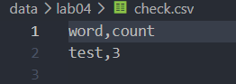
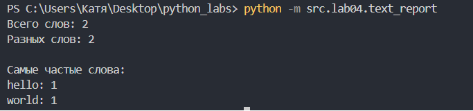
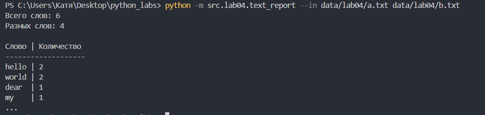
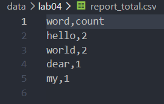
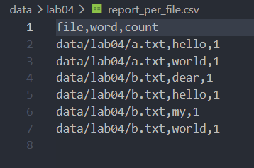

## ЛР3 — Тексты и частоты слов (словарь/множество)

## Задание A - модуль ввода/вывода `src/lab04/io_txt_csv.py`

### Функция `read_text`

```py
from pathlib import Path
import csv
from typing import Iterable, Sequence

def read_text(path: str | Path, encoding: str = "utf-8") -> str:
    '''
    This function reads text from the specified path
                
    Input data: path: str | Path, encoding: str = "utf-8"
    Output data: str
    '''

    return Path(path).read_text(encoding=encoding)
```

### Функция `write_csv`

```py
def write_csv(rows: Iterable[Sequence], path: str | Path, header: tuple[str, ...] | None = None) -> None:
    '''
    The function writes rows to a CSV file
                    
    Input data: rows: Iterable[Sequence], path: str | Path, header: tuple[str, ...] | None = None
    Output data: None
    Raises: ValueError("Strings have the different sizes")
    '''
    
    p = Path(path)
    rows = list(rows)

    dlina = len(rows[0]);
    for row in rows:
        if len(row) != dlina:
            raise ValueError("Strings have different sizes")

    with p.open("w", newline="", encoding="utf-8") as f:
        w = csv.writer(f)
        if header is not None:
            w.writerow(header)
        for r in rows:
            w.writerow(r)
```
### Функция `ensure_parent_dir`

```py
def ensure_parent_dir(path: str | Path) -> None:
    '''
    The function checks for the existence of the parent folder and creates it, along with any missing subfolders
                        
    Input data: rows: path: str | Path
    Output data: None
    '''

    Path(path).parent.mkdir(parents=True, exist_ok=True)
```
### Тесты для задания А

<br>
*Запись в CSV-файл*

## Задание B - скрипт `src/lab04/text_report.py`

### Исходный код `text_report.py`

```py
import argparse
from src.lab04.io_txt_csv import read_text, write_csv
from src.lib.text import normalize, tokenize, count_freq, top_n


# Set up command-line arguments
parser = argparse.ArgumentParser(description='Подсчет частоты слов в текстовых файлах')

parser.add_argument('--in', dest='input_files', nargs='+')
parser.add_argument('--out', dest='output_files', nargs='+')
parser.add_argument('--encoding', default='utf-8')
parser.add_argument('--per-file', default='data/lab04/report_per_file.csv')
parser.add_argument('--total', default='data/lab04/report_total.csv')

args = parser.parse_args()

def get_word_stats(filename):
    text = read_text(filename, encoding=args.encoding)
    text = normalize(text)
    words = tokenize(text)
    frequency = count_freq(words)

    return words, frequency

def show_top_words(frequency):
    popular_words = top_n(frequency, 5)

    print('Самые частые слова:')

    for word, amount in popular_words:
        print(f'{word}: {amount}')

# If there is one file
if args.input_files is None:

    filename = 'data/lab04/input.txt'
    words, frequency = get_word_stats(filename)

    # Choose the output file path
    if args.output_files:
        save_path = args.output_files[0]
    else:
        save_path = 'data/lab04/report.csv'

    result = top_n(frequency, len(frequency))
    write_csv(list(result), save_path, header=('word', 'count'))

    print(f'Всего слов: {len(words)}')
    print(f'Разных слов: {len(frequency)}')
    print()

    show_top_words(frequency)


# If there are more than one file
else:

    file_results = []
    total_frequency = {}

    for filename in sorted(args.input_files):

        words, frequency = get_word_stats(filename)

        sorted_words = top_n(frequency, len(frequency))

        for word, amount in sorted_words:
            file_results.append((filename, word, amount))

        for word, amount in frequency.items():

            if word in total_frequency:
                total_frequency[word] += amount
            else:
                total_frequency[word] = amount

    final_result = top_n(total_frequency, len(total_frequency))

    write_csv(
        file_results,
        args.per_file,
        header=('file', 'word', 'count')
    )

    write_csv(
        list(final_result),
        args.total,
        header=('word', 'count')
    )

    word_count = sum(total_frequency.values())
    different_words = len(total_frequency)

    print(f'Всего слов: {word_count}')
    print(f'Разных слов: {different_words}')
    print()

    popular_words = final_result[:5]

    column_width = max(
        [len(word) for word, amount in popular_words] + [len('Слово')]
    )

    print(f'{"Слово":<{column_width}} | Количество')
    print('-' * (column_width + 14))

    for word, amount in popular_words:
        print(f'{word:<{column_width}} | {amount}')

    print('...')
```
### Аргументы:
`--in` для входных файлов
`--out` отчёт для одного файла
`--encoding` кодировка входных файлов, по умолчанию utf-8
`--per-file` отчёт по каждому файлу
`--total` сводный отчёт

### Пример запуска для одного файла:
<br>
*Вызвано с помощью команды python -m src.lab04.text_report*

### Пример запуска для нескольких файлов:
<br>
*Вызвано с помощью команды python -m src.lab04.text_report --in data/lab04/a.txt data/lab04/b.txt*

### Создаются 2 файла:
<br>
*report_total.csv*
<br><br><br>
*report_per_file.csv*