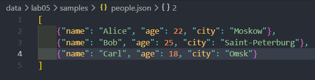
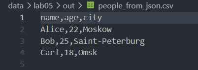
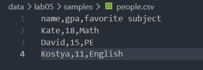
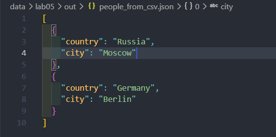
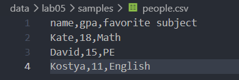
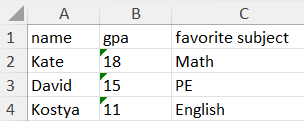

## ЛР5 — JSON и конвертации (JSON↔CSV, CSV→XLSX)

## Задание A - `src/lab04/json_csv.py`

### Функция `json_to_csv.py`
Функция `json_to_csv()` преобразует данные из JSON-файла в CSV-файл.
Сначала она проверяет существование и формат JSON-файла, затем считывает данные и проверяет их структуру. После этого собирает названия столбцов из ключей словарей и записывает данные в CSV в виде таблицы.
Если файл отсутствует или данные имеют неправильный формат, функция выдаёт ошибку.
```py
import json
import csv
from pathlib import Path
from src.lib.funcs import ensure_parent_dir


def json_to_csv(json_path: str, csv_path: str) -> None:
    '''
    The function reads data from JSON and writes it to a CSV (spreadsheet)
                    
    Input data: json_path: str, csv_path: str
    Output data: None
    Raises: FileNotFoundError("JSON file was not found"), ValueError("The file is not in JSON format"),
    ValueError("Empty file JSON"), ValueError("The JSON file is empty or has an invalid format")
    '''
    jp_file = Path(json_path)
    cp_file = Path(csv_path)

    if not jp_file.exists():
        raise FileNotFoundError("JSON file was not found")

    if jp_file.suffix.lower() != '.json':
        raise ValueError("The file is not in JSON format")

    try:
        with jp_file.open('r', encoding='utf-8') as f:
            data = json.load(f)
    except json.JSONDecodeError:
        raise ValueError("Not correct file JSON")

    if not isinstance(data, list) or not data:
        raise ValueError("The JSON file is empty or has an invalid format")

    for item in data:
        if not isinstance(item, dict):
            raise ValueError("All elements of a JSON list must be dictionaries.")

    fieldnames = []
    for element in data:
        for key in element:
            if key not in fieldnames:
                fieldnames.append(key)

    ensure_parent_dir(cp_file)

    with cp_file.open('w', newline="", encoding='utf-8') as f:
        writer = csv.DictWriter(f, fieldnames=fieldnames)
        writer.writeheader()

        for element in data:
            writer.writerow(element)
```

### Функция `csv_to_json.py`
Функция `csv_to_json()` преобразует данные из CSV-файла в JSON-файл.
Сначала она проверяет существование и формат CSV-файла, затем считывает данные и проверяет, что файл не пустой. После этого преобразует строки таблицы в список словарей и записывает их в JSON-файл.
Если файл отсутствует, имеет неправильное расширение или не содержит данных, функция выдаёт ошибку.
```py
def csv_to_json(csv_path: str, json_path: str) -> None:
    '''
    The function reads data from JSON and writes it to a CSV (spreadsheet)
                        
    Input data: csv_path: str, json_path: str
    Output data: None
    Raises: FileNotFoundError("CSV file was not found"), ValueError("The file is not in CSV format"),
    ValueError("File CSV without fieldnames"), ValueError("File CSV is empty")
    '''
    jp_file = Path(json_path)
    cp_file = Path(csv_path)

    if not cp_file.exists():
        raise FileNotFoundError("CSV file was not found")

    if cp_file.suffix.lower() != '.csv':
        raise ValueError("The file is not in CSV format")

    with cp_file.open("r", newline="", encoding="utf-8") as f:
        reader = csv.DictReader(f)
        if reader.fieldnames is None:
            raise ValueError("File CSV without fieldnames")

        data = []
        for row in reader:
            data.append(row)

    if len(data) == 0:
        raise ValueError("File CSV is empty")

    ensure_parent_dir(jp_file)

    with jp_file.open('w', encoding='utf-8') as p:
        json.dump(data, p, ensure_ascii=False, indent=2)

```
### Вызовы функций
```py
if __name__ == '__main__':
    json_to_csv(r'data\lab05\samples\people.json', r'data\lab05\out\people_from_json.csv')
    csv_to_json(r'data\lab05\samples\cities.csv', r'data\lab05\out\people_from_csv.json')

```

### Тесты для задания А

<br>
<br><br>
*Запись в CSV-файл - вызов `json_to_csv`*

<br><br>
<br><br>
*Запись в JSON-файл - вызов `csv_to_json`*

## Задание B - `src/lab05/csv_xlsx.py`
### Функция `csv_to_xlsx.py`
Функция `csv_to_xlsx()` преобразует данные из CSV-файла в Excel-файл формата XLSX.
Сначала она проверяет существование и формат CSV-файла, затем считывает данные и проверяет, что файл не пустой. После этого создаёт Excel-книгу, записывает в неё данные и автоматически настраивает ширину столбцов.
Если файл отсутствует, имеет неправильное расширение или пустой, функция выдаёт ошибку.
```py
import csv
from pathlib import Path
from openpyxl import Workbook
from src.lib.funcs import ensure_parent_dir


def csv_to_xlsx(csv_path: str, xlsx_path: str) -> None:
    '''
    The function writes data from CSV into XSLX

    Input data: csv_path: str, xlsx_path: str
    Output data: None
    Raises: FileNotFoundError("CSV file was not found"), ValueError("The file is not in CSV format"),
    ValueError("File CSV is empty")
    '''
    cp_file = Path(csv_path)
    xlp_file = Path(xlsx_path)

    if not cp_file.exists():
        raise FileNotFoundError("CSV file was not found")

    if cp_file.suffix.lower() != '.csv':
        raise ValueError("The file is not in CSV format")

    with cp_file.open('r', newline='', encoding='utf-8') as f:
        reader = []
        for row in csv.reader(f):
            reader.append(row)

    if len(reader) == 0:
        raise ValueError("File CSV is empty")

    wb = Workbook()
    w = wb.active
    assert w is not None
    w.title = "List"

    for row in reader:
        w.append(row)

    for col in w.columns:
        letter = col[0].column_letter
        max_len = 0

        for cell in col:
            if cell.value:
                cell_len = len(str(cell.value))
                max_len = max(max_len, cell_len)

        if max_len < 8:
            max_len = 8

        w.column_dimensions[letter].width = max_len

    ensure_parent_dir(xlp_file)
    wb.save(xlp_file)
```
### Вызов функции
```py
if __name__ == '__main__':
    csv_to_xlsx(r"data/lab05/samples/people.csv", r"data/lab05/out/people.xlsx")
```

### Тест для задания B
<br>
<br><br>
*Запись в XLSX-файл - вызов `csv_to_xlsx`*

###Результаты
- `data/lab05/samples/people.json` — список людей в формате JSON
- `data/lab05/samples/people.csv` — те же данные в формате CSV
- `data/lab05/samples/cities.csv` — данные в формате CSV с городами
- `data/lab05/out/people_from_json.csv` — результат функции `json_to_csv`
- `data/lab05/out/people_from_csv.json` — результат функции `csv_to_json`
- `data/lab05/out/people.xlsx` — результат функции `csv_to_xlsx`