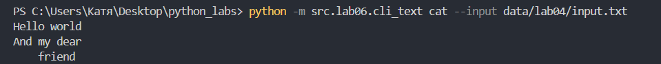
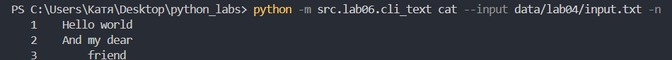
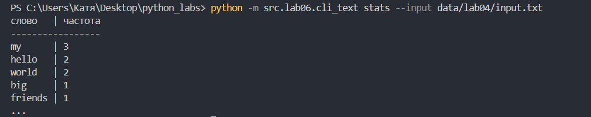
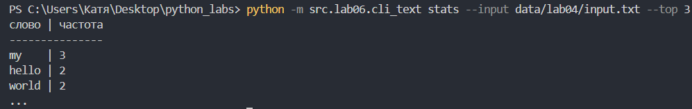
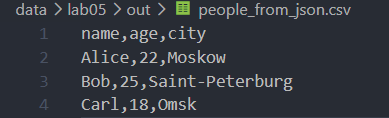
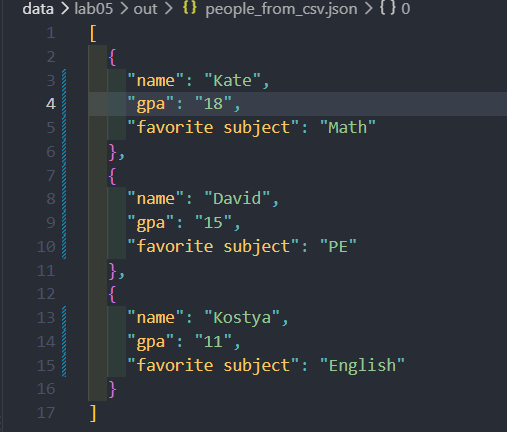
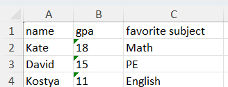
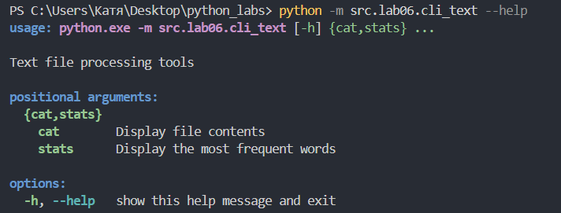
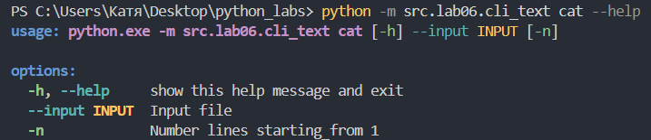

## ЛР6 — CLI‑утилиты с argparse (cat/grep‑lite + конвертеры)

## Задание A - модуль `cli_text.py`

### Подкоманда `cat`
Подкоманда `cat` предназначена для вывода содержимого текстового файла в консоль. При использовании флага -n строки выводятся с нумерацией, начиная с 1.

```py
python -m src.lab06.cli_text cat --input data/lab04/input.txt
```
<br>

Для нумерации строк используется `-n`:

```py
python -m src.lab06.cli_text cat --input data/lab04/input.txt -n
```
<br>

### Подкоманда `stats`
Подкоманда `stats` предназначена для подсчёта частоты встречаемости слов в текстовом файле и вывода наиболее часто встречающихся слов в консоль. Аргумент `--top` позволяет указать количество выводимых слов (по умолчанию — 5).

Запуск с количеством слов (по умолчанию):

```py
python -m src.lab06.cli_text stats --input data/lab04/input.txt
```
<br>


Запуск c заданием параметра `--top`(с собственным размером):

```py
python -m src.lab06.cli_text stats --input data/lab04/input.txt --top 3
```
<br>


## Задание B - модуль `cli_convert.py`

Модуль представляет 3 подкоманды:
`json_to_csv()` из `src.lab05.json_csv`
`csv_to_json()` из `src.lab05.json_csv`
`csv_to_xlsx()` из `src.lab05.csv_xlsx`

### Подкоманда `json2csv`
Подкоманда `json2csv` предназначена для преобразования файла из формата JSON в CSV. Аргумент `--in` указывает путь к исходному JSON-файлу, а `--out` — путь для сохранения полученного CSV-файла. Оба аргумента обязательны.

```py
python -m src.lab06.cli_convert json2csv --in data/lab05/samples/people.json --out data/lab05/out/people_from_json.csv
```
<br>

### Подкоманда `csv2json`
Подкоманда `csv2json` предназначена для преобразования файла из формата CSV в JSON. Аргумент `--in` указывает путь к исходному CSV-файлу, а `--out` — путь для сохранения полученного JSON-файла. Оба аргумента обязательны.

```py
python -m src.lab06.cli_convert csv2json --in data/lab05/samples/people.csv --out data/lab05/out/people_from_csv.json
```
<br>

### Подкоманда `csv2xlsx`
Подкоманда `csv2xlsx` предназначена для **преобразования файла из формата CSV в XLSX (Excel)**. Аргумент `--in` указывает путь к исходному CSV-файлу, а `--out` — путь для сохранения полученного XLSX-файла. Оба аргумента обязательны.

```py
python -m src.lab06.cli_convert csv2xlsx --in data/lab05/samples/people.csv --out data/lab05/out/people.xlsx
```
<br>

### Справка `--help`
Аргумент `--help` предназначен для вывода справочной информации о программе и её подкомандах. Он показывает доступные команды, аргументы, их назначение и обязательность. Справка формируется автоматически с помощью библиотеки `argparse`

Справка CLI:
```py
python -m src.lab06.cli_text --help
python -m src.lab06.cli_convert --help
```
<br>
*Пример для `cli_text`*<br>
Справка подкоманд:
```py
python -m src.lab06.cli_text cat --help
python -m src.lab06.cli_text stats --help
python -m src.lab06.cli_convert json2csv --help
python -m src.lab06.cli_convert csv2json --help
python -m src.lab06.cli_convert csv2xlsx --help
```
<br>
*Пример для `cat`*<br>

### Результаты
- `data/lab05/samples/people.json` — исходный JSON-файл с данными о людях
- `data/lab05/samples/people.csv` — исходный CSV-файл с данными о людях
- `data/lab05/samples/cities.csv` — исходный CSV-файл с данными о городах
- `data/lab05/out/people_from_json.csv` — результат работы подкоманды `json2csv`
- `data/lab05/out/people_from_csv.json` — результат работы подкоманды `csv2json`
- `data/lab05/out/people.xlsx` — результат работы подкоманды `csv2xlsx`
- `cat` — вывод содержимого выбранного текстового файла в консоль
- `cat -n` — вывод содержимого файла с нумерацией строк
- `stats` — вывод наиболее часто встречающихся слов и их частот в консоль
- `--help` — вывод справочной информации о программе и её аргументах