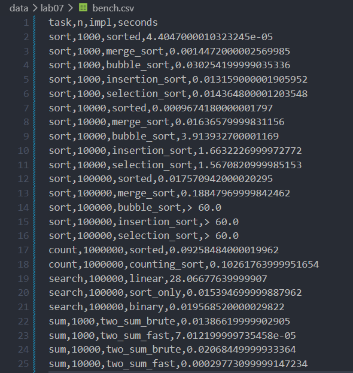

## ЛР7 — Поиск, сортировка и измерение времени

## Задание A - реализация `search.py`

### Функция `linear_search`
Последовательно перебирает элементы списка и сравнивает каждый с искомым значением x. Если элемент найден, возвращает его индекс, иначе -1.
Сложность: O(n).

```py
def linear_search(nums: list[int], x: int) -> int:
    '''
    Linear search

    Input: nums: list[int], x: int
    Output: int

    Complexity: O(n)
    '''

    for i in range(len(nums)):
        if nums[i] == x:
            return i
    return -1
```

### Функция `binary_search`
Выполняет поиск в отсортированном списке. На каждом шаге сравнивает искомое число со средним элементом и отбрасывает половину списка, в которой число не может находиться. Возвращает индекс найденного элемента или -1.
Сложность: O(log n).

```py
def binary_search(sorted_nums: list[int], x: int) -> int:
    '''
    Binary search

    Input: sorted_nums: list[int], x: int
    Output: int

    Complexity: O(log n)
    '''

    l = 0
    r = len(sorted_nums) - 1

    while l <= r:
        mid = (l + r) // 2

        if sorted_nums[mid] == x:
            return mid
        elif sorted_nums[mid] < x:
            l = mid + 1
        else:
            r = mid - 1

    return -1
```

### Функция `two_sum_brute`
Перебирает все возможные пары элементов списка и проверяет, равна ли их сумма заданному значению target. Если подходящая пара найдена, возвращает индексы двух элементов, иначе None.
Сложность: O(n**2).

```py
def two_sum_brute(nums: list[int], target: int) -> tuple[int, int] | None:
    '''
    Searching for two indices that help obtain the required amount (long)

    Input: nums: list[int], target: int
    Output: tuple[int, int] | None

    Complexity: O(n**2)
    '''
    n = len(nums)
    for i in range(n):
        for j in range(i + 1, n):
            if nums[i] + nums[j] == target:
                return (i, j)
    return None
```

### Функция `two_sum_fast`
Использует словарь для хранения ранее встреченных чисел и их индексов. Для каждого элемента вычисляет число, необходимое для получения заданной суммы, и проверяет его наличие в словаре. Возвращает индексы найденной пары или None.
Сложность: O(n).

```py
def two_sum_fast(nums: list[int], target: int) -> tuple[int, int] | None:
    '''
    Searching for two indices that help obtain the required amount (fast)

    Input: nums: list[int], target: int
    Output: tuple[int, int] | None

    Complexity: O(n)
    '''
    s = {}
    for i in range(len(nums)):
        x = nums[i]
        y = target - x
        if y in s:
            return (s[y], i)
        s[x] = i
    return None
```

## Задание B - реализация `sorting.py`

### Функция `bubble_sort`
Последовательно сравнивает соседние элементы списка и меняет их местами, если они стоят в неправильном порядке. Процесс повторяется до полной сортировки. Если за проход не было перестановок, алгоритм завершается досрочно.
Сложность: O(n**2), в лучшем случае O(n).

```py
def bubble_sort(nums: list[int]) -> list[int]:
    '''
    Optimized bubble sort

    Input: list[int]
    Output: list[int]

    Complexity: O(n**2)
    '''
    a = list(nums)
    n = len(a)

    for i in range(n):
        lamp = 0
        for j in range(0, n - (i + 1)):
            if a[j] > a[j + 1]:
                a[j], a[j + 1] = a[j + 1], a[j]
                lamp = 1

        if (not lamp):
            break

    return a
```

### Функция `selection_sort`
На каждом шаге находит минимальный элемент в неотсортированной части списка и перемещает его на нужную позицию. Повторяет процесс, пока весь список не будет отсортирован.
Сложность: O(n**2).

```py
def selection_sort(nums: list[int]) -> list[int]:
    ''' 
    Selection sort

    Input: nums: list[int]
    Output: list[int]

    Complexity: O(n**2)
    '''
    a = list(nums)
    n = len(a)

    for i in range(n):
        mn = i
        for j in range(i + 1, n):
            if a[j] < a[mn]:
                mn = j

        a[i], a[mn] = a[mn], a[i]

    return a
```

### Функция `insertion_sort`
Последовательно берёт элементы списка и вставляет каждый на правильную позицию среди уже отсортированных элементов, сдвигая большие значения вправо.
Сложность: O(n**2), в лучшем случае O(n).

```py
def insertion_sort(nums: list[int]) -> list[int]:
    '''
    Insertion_sort

    Input: nums: list[int]
    Output: list[int]

    Complexity: O(n**2)
    '''
    a = list(nums)
    n = len(a)

    for i in range(1, n):
        x = a[i]          
        j = i - 1

        while j >= 0 and a[j] > x:
            a[j + 1] = a[j]
            j -= 1

        a[j + 1] = x

    return a
```

### Функция `merge_sort`
Разделяет список на небольшие отсортированные участки и постепенно объединяет их в более крупные. При слиянии элементы сравниваются и записываются в правильном порядке. В данной реализации используется итеративный подход без рекурсии.
Сложность: O(n log n).

```py
def merge_sort(nums: list[int]) -> list[int]:
    '''
    Merge sort

    Input: nums: list[int]
    Output: list[int]

    Complexity: O(n log n)
    '''
    a = nums.copy()
    n = len(a)
    step = 1

    while step < n:
        l = 0

        while l < n:
            mid = min(l + step, n)
            r = min(mid + step, n)

            m = []
            i = l
            j = mid

            while i < mid or j < r:
                if j >= r or (i < mid and a[i] <= a[j]):
                    m.append(a[i])
                    i += 1
                else:
                    m.append(a[j])
                    j += 1

            a[l:r] = m
            l += 2 * step

        step *= 2

    return a
```

### Функция `counting_sort`
Подсчитывает количество повторений каждого числа в заданном диапазоне от l до r. Затем формирует отсортированный список, добавляя каждое число столько раз, сколько оно встретилось.
Сложность: O(n + k), где k — количество возможных значений.

```py
def counting_sort(nums: list[int], l: int, r: int) -> list[int]:
    '''
    Counting sort

    Complexity: O(n + k), k = (r - l)
    '''
    count = [0] * (r - l + 1)

    for i in range(len(nums)):
        index = nums[i] - l
        count[index] += 1

    res = []

    value = l
    while value <= r:
        amount = count[value - l]

        for i in range(amount):
            res.append(value)

        value += 1

    return res
```

## Задание C - реализация `check.py`
### `check_sorting()` и `check_counting_sort()` — проверка сортировок
Генерируют 100 случайных списков длиной от 0 до 50 элементов со значениями от −100 до 100. Сравнивают результат сортировки с `sorted()` и проверяют, что исходный список не изменился.

### `check_search()` — проверка алгоритмов поиска
Генерирует 100 случайных отсортированных списков. Проверяет линейный и бинарный поиск. Если элемент существует, проверяется правильность найденного индекса. Если отсутствует - функция должна вернуть -1.

### `check_two_sum()` — проверка поиска пары чисел
Генерирует 100 случайных списков и проверяет два алгоритма: `two_sum_brute()` и `two_sum_fast()`. Оба должны находить корректную пару индексов с заданной суммой либо возвращать None, если решения нет.

<br><br>
*Проверка корректной работы - вызов `check.py`*

## Задание D - реализация `bench.py`
Программа позволяет сравнить производительность различных алгоритмов и оценить зависимость времени их выполнения от размера входных данных.

```txt
Сравнение пяти алгоритмов сортировки на разных размерах списков...
Сравнение встроенной сортировки Python и сортировки подсчётом...
Сравнение линейного и бинарного поиска...
Сравнение полного перебора и быстрого алгоритма Two Sum...

task       | n          | impl            | seconds
-------------------------------------------------------
sort       | 1000       | sorted          | 0.000044
sort       | 1000       | merge_sort      | 0.001447
sort       | 1000       | bubble_sort     | 0.030254
sort       | 1000       | insertion_sort  | 0.013159
sort       | 1000       | selection_sort  | 0.014365
sort       | 10000      | sorted          | 0.000967
sort       | 10000      | merge_sort      | 0.016366
sort       | 10000      | bubble_sort     | 3.913933
sort       | 10000      | insertion_sort  | 1.663223
sort       | 10000      | selection_sort  | 1.567082
sort       | 100000     | sorted          | 0.017571
sort       | 100000     | merge_sort      | 0.188480
sort       | 100000     | bubble_sort     | > 60.0
sort       | 100000     | insertion_sort  | > 60.0
sort       | 100000     | selection_sort  | > 60.0
count      | 1000000    | sorted          | 0.092585
count      | 1000000    | counting_sort   | 0.102618
search     | 100000     | linear          | 28.066776
search     | 100000     | sort_only       | 0.015395
search     | 100000     | binary          | 0.019569
sum        | 1000       | two_sum_brute   | 0.013866
sum        | 1000       | two_sum_fast    | 0.000070
sum        | 10000      | two_sum_brute   | 0.020684
sum        | 10000      | two_sum_fast    | 0.000298
```
*Вывод `bench.py`*

Результаты выводятся в консоль и сохраняются в CSV-файл.
<br><br>
*Запись в `bench.csv`*
